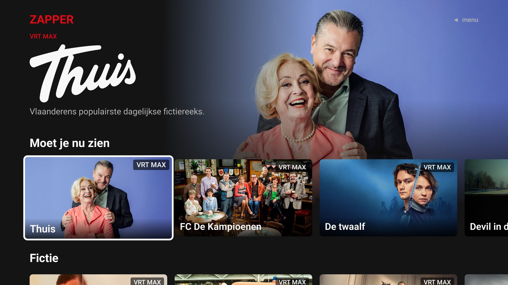
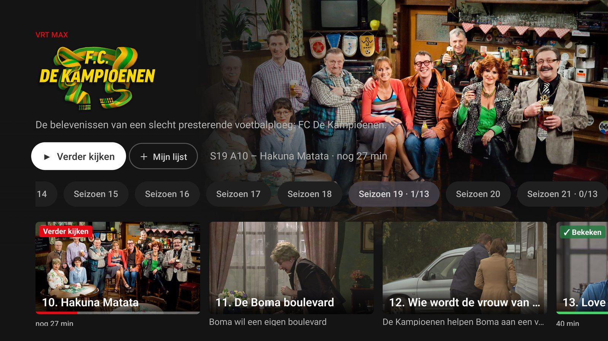
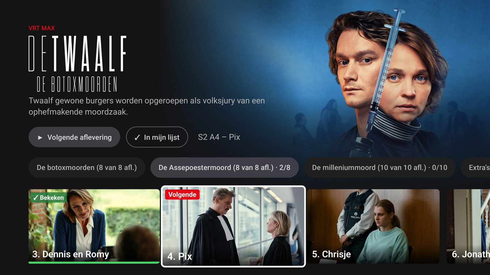
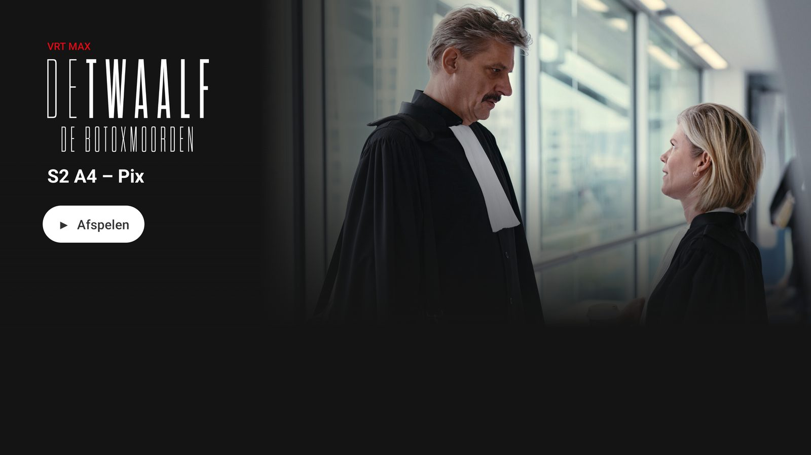
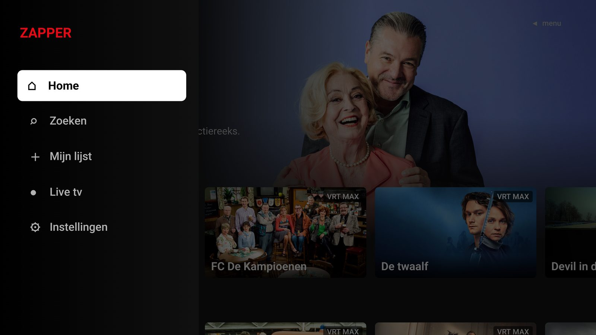
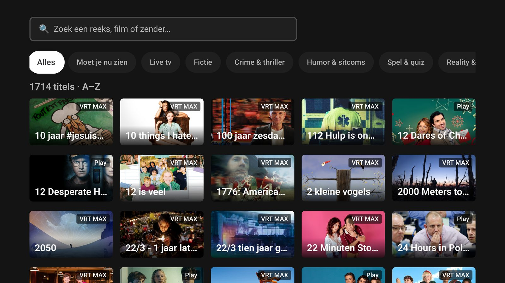
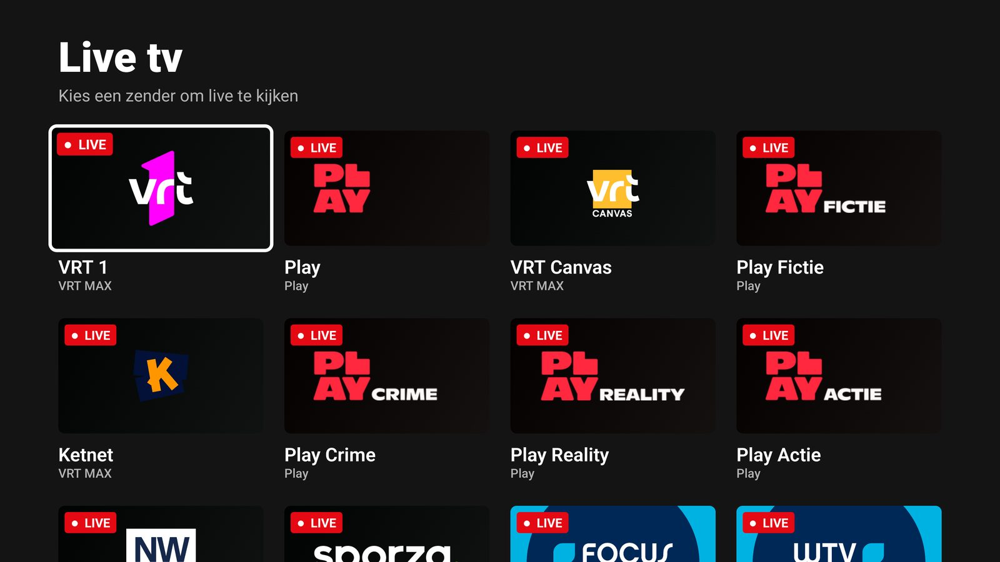
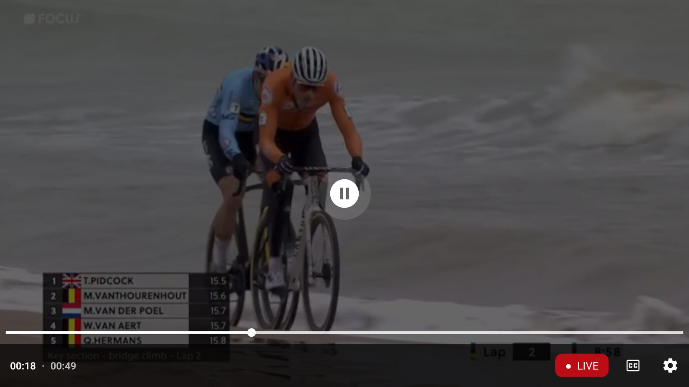

# Zapper

Eén Android TV-app voor de Vlaamse streamingplatformen, met een Netflix-achtige interface.
VRT MAX, VTM GO, Play en de live-zenders van Focus en WTV staan samen in één app: door elkaar in gedeelde rijen
(Fictie, Crime & thriller, Humor, Docu, …), met één "Verder kijken" en één "Mijn lijst" voor alle zenders.



> Persoonlijk project, niet gelinkt aan VRT, DPG Media, Play Media of Focus & WTV. Je kijkt met je eigen
> (gratis) accounts; DRM wordt niet omzeild.

## Wat kan Zapper?

- **Eén startscherm voor alle zenders** – rijen per genre met programma's van alle zenders door elkaar,
  en "Moet je nu zien" uit de populaire lijsten van de zenders zelf.
- **Verder kijken zoals op de website** – Zapper volgt wat VRT MAX en Play zelf bijhouden en meldt
  je voortgang terug. Begin je op je gsm, dan kijk je verder op de TV, en omgekeerd.
- **De volgende aflevering staat klaar** – open een reeks en Zapper selecteert het juiste seizoen en
  de aflevering waar je zat. Bekeken afleveringen en seizoenen zijn gemarkeerd.
- **Mijn lijst** – bewaar programma's; de lijst is dezelfde als in de app of op de website van de zender.
- **Live tv** – alle live-zenders op één pagina, de populairste eerst, met een knop "Naar live" als je achterloopt.
- **Zoeken en bladeren** – door de volledige catalogus A–Z of per categorie.
- **Gemaakt voor de afstandsbediening** – spoelen met de pijltjes, ondertitels met één knop.
- **Werkt zichzelf bij** – de app en de zenders worden automatisch bijgewerkt.

## Zenders

| Zender | Inhoud | Account |
|---|---|---|
| VRT MAX | programma's, films, live: VRT 1, VRT Canvas, Ketnet, Sporza, VRT NWS | gratis VRT-profiel |
| VTM GO | programma's, films, live: VTM, VTM 2, VTM 3, VTM 4, VTM GOLD, … | gratis VTM GO-account (login met code) |
| Play | programma's, films, live: Play, Play Fictie, Play Crime, Play Reality, Play Actie, Nostalgie | gratis Play-account |
| Focus & WTV | live: Focus, WTV | geen login nodig |

Play Kinepolis (huur- en koopfilms) zit er niet in. Van VTM GO toont Zapper enkel het gratis aanbod:
programma's, seizoenen en afleveringen van VTM GO+, Streamz en VTM GO Cinema (huren) zie je niet.
"Kijk verder" en je kijkpositie lopen gelijk met de VTM GO-app en vtmgo.be.

## In beeld

| | |
|---|---|
|  **Programma** – verder kijken waar je zat, bekeken seizoenen en afleveringen. |  **Afleveringen** – "Volgende" en "✓ Bekeken" in één oogopslag. |
|  **Aflevering** – eerst info, dan afspelen. |  **Menu** – Home, Zoeken, Mijn lijst, Live tv en Instellingen. |
|  **Zoeken** – alles A–Z, of filter op categorie. |  **Live tv** – alle zenders, populairste eerst. |
|  **Live kijken** – "● LIVE", of "Naar live" als je achterloopt. | |

## Installeren op je TV

Zapper staat niet in de Play Store; je installeert de app één keer zelf ("sideloaden").

**Met de app Downloader** (makkelijkst):

1. Installeer *Downloader* (AFTVnews) uit de Play Store op je TV.
2. Sta in de TV-instellingen *Apps van onbekende bronnen* toe voor Downloader.
3. Open in Downloader de link naar `app-release.apk` van de
   [laatste release](https://github.com/Verdonck-IT/zapper/releases/latest) en installeer.

**Met een computer** (adb):

```bash
adb connect <ip-van-je-tv>:5555
adb install app-release.apk
```

Sta daarna *onbekende bronnen* toe voor Zapper zelf; zo kan de app zichzelf bijwerken.

### Eerste keer

1. Open Zapper, druk ◀ en kies **Instellingen**.
2. Log in bij VRT MAX en Play met je eigen account. Focus & WTV heeft geen login nodig.
   VTM GO werkt met een code, zoals de eigen TV-app: kies **Inloggen met code**, ga op je gsm of computer
   naar **login.vtm.be/androidtv** en geef de code in die op de TV staat.
3. Kies **Catalogus nu syncen**, of wacht even: de catalogus wordt automatisch opgebouwd.

## Bediening

| Waar | Toets | Wat |
|---|---|---|
| Startscherm | ◀ op de linkerrand, of **terug** bovenaan | menu openen |
| Startscherm, zoeken, lijsten | **terug** | eerst naar boven, dan terug; de app sluit nooit vanzelf |
| Programma, aflevering | **terug** | meteen terug naar het vorige scherm |
| Verder kijken | **OK ingedrukt houden** | naar het programma, of verwijderen uit Verder kijken |
| Player | ◀ / ▶ | 10 seconden spoelen; ingedrukt houden gaat sneller (30 s, 60 s) |
| Player | **OK** | pauze / verder |
| Player | ▼ | naar de ondertitelknop (CC); ◀ daarnaast: **Naar live** |
| Player | **CC-toets** | ondertitels aan/uit (wordt onthouden) |

Gebruik je Zapper een tijdje niet, dan verschijnt een donkere, OLED-veilige screensaver
(na 5 minuten, of na 3 minuten met een gepauzeerde video). Daarna neemt de slaapstand van je TV het over.
Tijdens het afspelen gebeurt dat nooit.

## Goed om te weten

- De beeldkwaliteit hangt af van je TV (Widevine L1 of L3).
- Sommige inhoud is enkel beschikbaar in België.
- Problemen of ideeën? Maak een [issue](https://github.com/Verdonck-IT/zapper/issues).

## Voor ontwikkelaars

Architectuur, plugins, de build- en publicatiestraat en hoe je een zender toevoegt:
zie [docs/TECHNISCH.md](docs/TECHNISCH.md).
